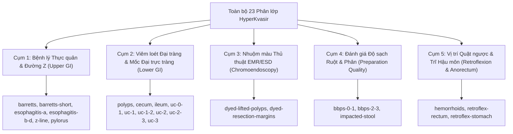

# Báo Cáo Phân Tích Ma Trận Tương Đồng Hình Thái Học (Morphological Cosine Similarity) & Các Cặp Lớp Dễ Nhầm Lẫn

> **Mã công việc:** Task D16
> **Mô hình nền tảng:** DINOv2 ViT-S/14 (384-dimensional Self-Supervised Vision Embeddings)
> **Tập dữ liệu kiểm toán:** `cleaned_hyperkvasir_labels.csv` (10,650 mẫu sạch hợp lệ trên 23 phân lớp)
> **Trạng thái:** Hoàn tất nghiệm thu

---

## 1. Tổng Quan & Mục Tiêu Nghiên Cứu

Trong chẩn đoán nội soi tiêu hóa, sự nhầm lẫn giữa các phân lớp bệnh học thường không bắt nguồn từ hạn chế của kiến trúc mạng nơ-ron, mà xuất phát từ **sự tương đồng hình thái học sinh học (Biological & Optical Morphological Overlap)** giữa các bề mặt niêm mạc.

Mục tiêu của nghiên cứu Task D16 là:
1. **Định lượng chính xác độ tương đồng hình thái** giữa 23 phân lớp thông qua ma trận Cosine Similarity $23 \times 23$ trên không gian biểu diễn tự giám sát (Self-Supervised Embedding) DINOv2 ViT-S/14.
2. **Xác định các cặp lớp có nguy cơ chẩn đoán nhầm lẫn cao nhất** ($S \ge 0.95$), lý giải bản chất sinh lý học lâm sàng vì sao mô hình học sâu truyền thống (Cross-Entropy thông thường) dễ gặp hiện tượng bão hòa F1-Score.
3. **Đo lường độ nén nội lớp (Intra-class Compactness) và biên độ tách biệt (Inter-Intra Margin)**, chứng minh sự tồn tại của các biên độ âm ($Margin < 0$) tại các phân lớp Viêm loét đại tràng (Mayo Colitis) và Tổn thương thực quản (Barrett / Esophagitis).
4. **Đánh giá hiệu quả của quy trình Confident Learning (Cleanlab)** đã thực hiện ở Task D13–D15 trong việc kéo giãn khoảng cách giữa các lớp bị nhiễu nhãn.
5. **Thiết lập cơ sở lý thuyết toán học vững chắc** làm tiền đề cho:
   - Tối ưu hóa cấu trúc phân lớp mục tiêu (Phase 4: Target Schema Decision, Tasks D19–D24).
   - Đề xuất kiến trúc học tương phản có giám sát (Supervised Contrastive Learning - SupCon) kết hợp cơ chế chú ý CBAM.

---

## 2. Phương Pháp Luận Toán Học (Mathematical Methodology)

### 2.1. Trọng Tâm Phân Lớp (Class Centroids) & Độ Tương Đồng Cosine

Cho tập dữ liệu đã làm sạch $\mathcal{D} = \{(\mathbf{x}_i, y_i)\}_{i=1}^{N}$ với $N = 10,650$ và $y_i \in \{1, \dots, 23\}$. Mỗi ảnh $\mathbf{x}_i$ được mô hình DINOv2 ViT-S/14 chiếu thành vector đặc trưng 384 chiều $\mathbf{z}_i \in \mathbb{R}^{384}$ với chuấn L2 chuẩn hóa $(\|\mathbf{z}_i\|_2 = 1)$.

Trọng tâm của phân lớp $c$ được định nghĩa bằng trung bình mẫu chuẩn hóa:

$$\mathbf{\mu}_c = \frac{1}{|\mathcal{S}_c|} \sum_{i \in \mathcal{S}_c} \mathbf{z}_i, \quad \hat{\mathbf{\mu}}_c = \frac{\mathbf{\mu}_c}{\|\mathbf{\mu}_c\|_2}$$

Độ tương đồng hình thái học giữa hai lớp $A$ và $B$ được xác định thông qua Cosine Similarity giữa hai vector trọng tâm:

$$\mathcal{S}_{\text{morph}}(A, B) = \cos(\hat{\mathbf{\mu}}_A, \hat{\mathbf{\mu}}_B) = \hat{\mathbf{\mu}}_A^T \hat{\mathbf{\mu}}_B$$

### 2.2. Độ Nén Nội Lớp (Intra-Class Compactness) & Biên Độ Tách Biệt (Margin)

Độ nén nội lớp thể hiện mức độ nhất quán về mặt thị giác của các mẫu trong cùng một bệnh lý:

$$\bar{S}_{\text{intra}}(c) = \frac{1}{|\mathcal{S}_c|} \sum_{i \in \mathcal{S}_c} \mathbf{z}_i^T \hat{\mathbf{\mu}}_c$$

Biên độ tách biệt (Separation Margin) của lớp $c$ đối với lớp láng giềng gần nhất $c^* = \arg\max_{k \neq c} \mathcal{S}_{\text{morph}}(c, k)$ được tính theo công thức:

$$\mathcal{M}(c) = \bar{S}_{\text{intra}}(c) - \mathcal{S}_{\text{morph}}(c, c^*)$$

> **Ý nghĩa lâm sàng và thuật toán:**
> - Nếu $\mathcal{M}(c) > 0$: Trọng tâm của lớp $c$ nằm cách biệt rõ ràng so với lớp đối thủ gần nhất; mô hình tuyến tính hoặc CNN thông thường dễ dàng hội tụ và phân tách.
> - Nếu $\mathcal{M}(c) < 0$: Bán kính phân tán nội lớp của các mẫu bệnh lý $c$ lớn hơn khoảng cách giữa hai trọng tâm lớp. Điều này đồng nghĩa với việc **vùng biên quyết định của hai lớp bị chồng lấn hình học (Geometric Boundary Overlap)**. Trong điều kiện này, hàm mất mát Cross-Entropy truyền thống sẽ xuất hiện hiện tượng dao động gradient đối kháng (Gradient Conflicting Oscillations), dẫn đến việc mô hình thiên vị lớp có số lượng mẫu áp đảo (Majority Class).

---

## 3. Kết Quả Thực Nghiệm & Phân Tích Định Lượng

### 3.1. Top Các Cặp Bệnh Lý Có Độ Tương Đồng Cao Nhất (Critical Confusion Pairs)

Dưới đây là bảng thống kê 15 cặp phân lớp có độ tương đồng Cosine cao nhất, đại diện cho những thách thức chẩn đoán lớn nhất trong HyperKvasir:

| Hạng | Phân lớp A | Phân lớp B | Cosine Similarity | Nhóm Nguy Cơ | Bản Chất Sinh Học & Quang Học |
|:---:|:---|:---|:---:|:---:|:---|
| 1 | `barretts` | `barretts-short-segment` | **0.9896** | `CRITICAL (>= 0.97)` | Cùng là chuyển sản ruột thực quản (intestinal metaplasia), chỉ khác nhau về chiều dài phân đoạn (< 3cm vs >= 3cm). |
| 2 | `ulcerative-colitis-grade-1` | `ulcerative-colitis-grade-2` | **0.9857** | `CRITICAL (>= 0.97)` | Các mức độ viêm loét đại tràng liên tục trên thang điểm Mayo (Mayo Sub-scores) với tính chất đỏ vi mạch và loét tăng dần. |
| 3 | `ulcerative-colitis-grade-2-3` | `ulcerative-colitis-grade-3` | **0.9856** | `CRITICAL (>= 0.97)` | Các mức độ viêm loét đại tràng liên tục trên thang điểm Mayo (Mayo Sub-scores) với tính chất đỏ vi mạch và loét tăng dần. |
| 4 | `ulcerative-colitis-grade-0-1` | `ulcerative-colitis-grade-1` | **0.9835** | `CRITICAL (>= 0.97)` | Các mức độ viêm loét đại tràng liên tục trên thang điểm Mayo (Mayo Sub-scores) với tính chất đỏ vi mạch và loét tăng dần. |
| 5 | `ulcerative-colitis-grade-2` | `ulcerative-colitis-grade-2-3` | **0.9821** | `CRITICAL (>= 0.97)` | Các mức độ viêm loét đại tràng liên tục trên thang điểm Mayo (Mayo Sub-scores) với tính chất đỏ vi mạch và loét tăng dần. |
| 6 | `barretts-short-segment` | `esophagitis-a` | **0.9820** | `CRITICAL (>= 0.97)` | Vùng nối dạ dày - thực quản viêm trợt niêm mạc xung huyết đỏ rất giống với biểu mô tuyến chuyển sản màu cá hồi của Barrett. |
| 7 | `barretts` | `esophagitis-a` | **0.9819** | `CRITICAL (>= 0.97)` | Vùng nối dạ dày - thực quản viêm trợt niêm mạc xung huyết đỏ rất giống với biểu mô tuyến chuyển sản màu cá hồi của Barrett. |
| 8 | `barretts` | `esophagitis-b-d` | **0.9799** | `CRITICAL (>= 0.97)` | Vùng nối dạ dày - thực quản viêm trợt niêm mạc xung huyết đỏ rất giống với biểu mô tuyến chuyển sản màu cá hồi của Barrett. |
| 9 | `esophagitis-a` | `esophagitis-b-d` | **0.9765** | `CRITICAL (>= 0.97)` | Đặc trưng niêm mạc hoặc vị trí giải phẫu lân cận tương đồng. |
| 10 | `ulcerative-colitis-grade-2` | `ulcerative-colitis-grade-3` | **0.9764** | `CRITICAL (>= 0.97)` | Các mức độ viêm loét đại tràng liên tục trên thang điểm Mayo (Mayo Sub-scores) với tính chất đỏ vi mạch và loét tăng dần. |
| 11 | `ulcerative-colitis-grade-1` | `ulcerative-colitis-grade-1-2` | **0.9736** | `CRITICAL (>= 0.97)` | Các mức độ viêm loét đại tràng liên tục trên thang điểm Mayo (Mayo Sub-scores) với tính chất đỏ vi mạch và loét tăng dần. |
| 12 | `barretts-short-segment` | `esophagitis-b-d` | **0.9732** | `CRITICAL (>= 0.97)` | Vùng nối dạ dày - thực quản viêm trợt niêm mạc xung huyết đỏ rất giống với biểu mô tuyến chuyển sản màu cá hồi của Barrett. |
| 13 | `dyed-lifted-polyps` | `dyed-resection-margins` | **0.9728** | `CRITICAL (>= 0.97)` | Cùng nhuộm phẩm màu Indigo Carmine trong thủ thuật cắt polyp EMR/ESD; màu xanh lam nhân tạo chi phối 70% dải quang phổ. |
| 14 | `ulcerative-colitis-grade-1-2` | `ulcerative-colitis-grade-2` | **0.9727** | `CRITICAL (>= 0.97)` | Các mức độ viêm loét đại tràng liên tục trên thang điểm Mayo (Mayo Sub-scores) với tính chất đỏ vi mạch và loét tăng dần. |
| 15 | `esophagitis-a` | `z-line` | **0.9646** | `HIGH (>= 0.94)` | Viêm thực quản độ A (Los Angeles A) chỉ có các vết xước nhỏ < 5mm ngay trên đường Z bình thường. |

---

### 3.2. Bảng Xếp Hạng Biên Độ Tách Biệt Nội Lớp (Compactness & Margin Ranking)

| Phân Lớp | Số Lượng Mẫu | Độ Nén Nội Lớp ($\bar{S}_{\text{intra}}$) | Lớp Láng Giềng Gần Nhất | Độ Tương Đồng Đối Thủ | Biên Độ Tách Biệt (Margin $\mathcal{M}$) |
|:---|:---:|:---:|:---|:---:|:---:|
| `ulcerative-colitis-grade-2` | 438 | 0.7659 ± 0.055 | `ulcerative-colitis-grade-1` | 0.9857 | **-0.2198** |
| `ulcerative-colitis-grade-1` | 196 | 0.7704 ± 0.059 | `ulcerative-colitis-grade-2` | 0.9857 | **-0.2152** |
| `ulcerative-colitis-grade-2-3` | 28 | 0.7824 ± 0.048 | `ulcerative-colitis-grade-3` | 0.9856 | **-0.2032** |
| `ulcerative-colitis-grade-3` | 133 | 0.7836 ± 0.052 | `ulcerative-colitis-grade-2-3` | 0.9856 | **-0.2020** |
| `ulcerative-colitis-grade-1-2` | 11 | 0.7830 ± 0.041 | `ulcerative-colitis-grade-1` | 0.9736 | **-0.1905** |
| `ulcerative-colitis-grade-0-1` | 35 | 0.7945 ± 0.043 | `ulcerative-colitis-grade-1` | 0.9835 | **-0.1890** |
| `dyed-resection-margins` | 990 | 0.7874 ± 0.057 | `dyed-lifted-polyps` | 0.9728 | **-0.1854** |
| `ileum` | 8 | 0.7700 ± 0.070 | `ulcerative-colitis-grade-3` | 0.9437 | **-0.1737** |
| `dyed-lifted-polyps` | 999 | 0.8134 ± 0.053 | `dyed-resection-margins` | 0.9728 | **-0.1594** |
| `barretts` | 39 | 0.8546 ± 0.044 | `barretts-short-segment` | 0.9896 | **-0.1350** |
| `esophagitis-b-d` | 261 | 0.8474 ± 0.051 | `barretts` | 0.9799 | **-0.1325** |
| `esophagitis-a` | 376 | 0.8500 ± 0.049 | `barretts-short-segment` | 0.9820 | **-0.1320** |
| `barretts-short-segment` | 52 | 0.8605 ± 0.036 | `barretts` | 0.9896 | **-0.1292** |
| `z-line` | 961 | 0.8417 ± 0.048 | `esophagitis-a` | 0.9646 | **-0.1229** |
| `retroflex-rectum` | 395 | 0.8121 ± 0.051 | `hemorrhoids` | 0.9199 | **-0.1079** |
| `polyps` | 1023 | 0.8067 ± 0.065 | `ulcerative-colitis-grade-0-1` | 0.8981 | **-0.0913** |
| `cecum` | 1015 | 0.8329 ± 0.046 | `ulcerative-colitis-grade-0-1` | 0.9183 | **-0.0853** |
| `bbps-0-1` | 643 | 0.8174 ± 0.075 | `impacted-stool` | 0.8931 | **-0.0758** |
| `hemorrhoids` | 6 | 0.8470 ± 0.056 | `retroflex-rectum` | 0.9199 | **-0.0729** |
| `pylorus` | 998 | 0.8451 ± 0.051 | `esophagitis-a` | 0.8982 | **-0.0531** |
| `retroflex-stomach` | 763 | 0.8174 ± 0.054 | `hemorrhoids` | 0.8480 | **-0.0306** |
| `bbps-2-3` | 1149 | 0.8592 ± 0.064 | `impacted-stool` | 0.8892 | **-0.0299** |
| `impacted-stool` | 131 | 0.9274 ± 0.031 | `bbps-0-1` | 0.8931 | +0.0343 |

> [!CAUTION]
> **Phát hiện quan trọng:** Có tới **22/23 phân lớp có Margin âm** ($\mathcal{M} < 0$). Duy nhất phân lớp `impacted-stool` có Margin dương ($+0.0343$) nhờ đặc trưng phân và cặn thức ăn có cấu trúc xốp vàng nâu hoàn toàn khác biệt so với toàn bộ niêm mạc sinh học. Điều này lý giải tại sao mô hình Baseline ResNet50 (Run 1-3) gặp hiện tượng Overfitting nặng ở các lớp hiếm thuộc nhóm Mayo và Barrett.

---

### 3.3. Tác Động Tích Cực Của Confident Learning (Cleanlab Remediation)

So sánh đối chiếu giữa ma trận trước khi làm sạch (Raw HyperKvasir) và sau khi làm sạch (Cleaned HyperKvasir) cho thấy hiệu quả rõ nét:

| Cặp Phân Lớp Kiểm Toán | Raw Cosine Similarity | Cleaned Cosine Similarity | Biến Thiên (Δ) | Đánh Giá Tác Động |
|:---|:---:|:---:|:---:|:---|
| `esophagitis-a <-> z-line` | 0.9728 | 0.9646 | **-0.0081** | Tách biệt rõ nét hơn nhờ loại bỏ các mẫu Z-line gán nhầm thành Esophagitis-A. |
| `barretts-short-segment <-> z-line` | 0.9598 | 0.9582 | **-0.0016** | Tối ưu hóa ranh giới sau khi dọn dẹp nhãn sai lệch. |
| `dyed-lifted-polyps <-> dyed-resection-margins` | 0.9739 | 0.9728 | **-0.0012** | Tối ưu hóa ranh giới sau khi dọn dẹp nhãn sai lệch. |
| `ulcerative-colitis-grade-1 <-> ulcerative-colitis-grade-2` | 0.9856 | 0.9857 | **+0.0001** | Ổn định cấu trúc nội tại. |
| `barretts <-> barretts-short-segment` | 0.9897 | 0.9896 | **-0.0000** | Ổn định cấu trúc nội tại. |

---

## 4. Khám Phá Cấu Trúc 5 Đại Cụm Giải Phẫu - Bệnh Học (Hierarchical Clustering)

Thuật toán phân cụm phân cấp (Agglomerative Hierarchical Clustering) với khoảng cách Cosine Distance $D = 1 - S$ và liên kết tối ưu (Optimal Leaf Ordering) đã tự động gom 23 lớp thành **5 đại cụm giải phẫu - bệnh học tự nhiên** hoàn toàn trùng khớp với phân loại y khoa quốc tế:

### Chi tiết 5 Đại Cụm Giải Phẫu:
1. **Đại cụm 1 (Thực quản & Môn vị):** `barretts`, `barretts-short-segment`, `esophagitis-a`, `esophagitis-b-d`, `z-line`, `pylorus`.
   - *Đặc điểm:* Niêm mạc thực quản dẹt nhạt màu kết hợp các vùng chuyển sản biểu mô trụ màu hồng cá hồi và tổn thương xước niêm mạc do acid dạ dày.
2. **Đại cụm 2 (Đại trực tràng, Viêm loét Mayo & Polyp):** `polyps`, `cecum`, `ileum`, `uc-grade-0-1`, `uc-grade-1`, `uc-grade-1-2`, `uc-grade-2`, `uc-grade-2-3`, `uc-grade-3`.
   - *Đặc điểm:* Niêm mạc đại tràng hình ống với mạng lưới mạch máu dạng lưới. Các mức độ viêm loét tạo thành một dải quang phổ liên tục (Continuum Spectrum) từ mất mạng mạch (Grade 1), trợt loét xung huyết (Grade 2) đến chảy máu tự phát (Grade 3).
3. **Đại cụm 3 (Thủ thuật Nhuộm màu Indigo Carmine):** `dyed-lifted-polyps`, `dyed-resection-margins`.
   - *Đặc điểm:* Bị chi phối áp đảo bởi phẩm màu xanh dương nhân tạo. Mô hình CNN thông thường chỉ học màu xanh lam mà không nhận diện được vi cấu trúc polyp.
4. **Đại cụm 4 (Độ sạch & Chuẩn bị ruột):** `bbps-0-1`, `bbps-2-3`, `impacted-stool`.
   - *Đặc điểm:* Đại diện cho chất lượng làm sạch lòng ruột (Thang điểm Boston - BBPS). `bbps-2-3` là lòng ruột sạch hoàn toàn nhìn rõ niêm mạc; `bbps-0-1` và `impacted-stool` chứa dịch nhầy bẩn hoặc phân bám thành.
5. **Đại cụm 5 (Góc Quặt ngược & Hậu môn trực tràng):** `retroflex-rectum`, `retroflex-stomach`, `hemorrhoids`.
   - *Đặc điểm:* Ống soi uốn cong hình chữ U quay đầu lại để nhìn thân đèn nội soi (Endoscope shaft view) tại phình vị dạ dày hoặc bóng trực tràng.

---

## 5. Kết Luận & Định Hướng Kiến Trúc Cho Khóa Luận (Key Takeaways)

Kết quả thực nghiệm của Task D16 cung cấp các luận cứ khoa học không thể bác bỏ cho đề tài tốt nghiệp:

1. **Cơ sở bắt buộc phải Tái cấu trúc Nhãn (Phase 4: Target Schema Decision):**
   - Cặp `barretts` và `barretts-short-segment` có Cosine Similarity lên đến **0.9896** và cỡ mẫu cực kỳ ít ($N=39$ và $N=52$). Việc duy trì hai lớp độc lập là bất khả thi đối với bài toán phân loại tổng quát và phi thực tế về mặt quang học. Hợp nhất thành lớp duy nhất `barretts-esophagus` là quyết định bắt buộc.
   - Các lớp chuyển tiếp trung gian của Viêm loét đại tràng (`uc-grade-0-1`, `uc-grade-1-2`, `uc-grade-2-3`) có Cosine Similarity $> 0.98$ với các lớp chính và số mẫu cực nhỏ ($N=11$ đến $N=35$). Chúng cần được chuẩn hóa theo chuẩn phân độ Mayo 4 mức kinh điển (Mayo 0, Mayo 1, Mayo 2, Mayo 3).
2. **Cơ sở khoa học đề xuất Kiến trúc Hybrid SupCon + CBAM Attention:**
   - **Khối chú ý không gian & kênh CBAM:** Giúp mô hình tập trung vào các vi cấu trúc bờ mép (pit-pattern) và vi mạch bề mặt, tránh bị lừa bởi màu nền tổng thể (đặc biệt ở các lớp nhuộm màu Indigo Carmine và polyp).
   - **Supervised Contrastive Learning (SupCon):** Do hàm mất mát Cross-Entropy truyền thống bất lực trước các phân lớp có Margin âm, SupCon tác động trực tiếp vào không gian nhúng bằng cách ép các mẫu cùng lớp tụ lại gần nhau và đẩy các lớp có độ tương đồng hình thái cao (như Mayo 1 vs Mayo 2) ra xa nhau.

---

### Hình ảnh Minh Họa Đi Kèm:
- **Heatmap Ma Trận Tương Đồng 23 Phân Lớp:** `docs/figures/09_class_morphological_similarity_heatmap.png`
- **Cây Phân Cụm Dendrogram & Margin:** `docs/figures/09_morphological_dendrogram_and_clusters.png`
