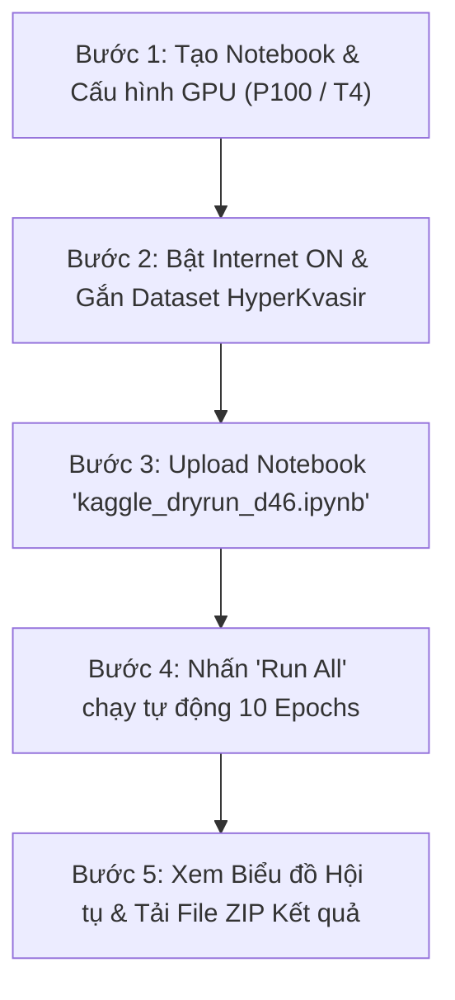

# HƯỚNG DẪN THỰC THI STEP-BY-STEP: TASK D46 - DRY-RUN 10 EPOCHS TRÊN KAGGLE GPU
**Dự án Khóa luận Tốt nghiệp:** Ứng dụng Học Sâu trong Nhận diện và Phân loại Tổn thương Đường Tiêu hóa từ Ảnh Nội soi (`GIEndoDL`)
**Sinh viên thực hiện:** Lê Huy Phát | **Trường:** Đại học Công Thương TP.HCM (HUIT)
**Tiêu chuẩn Y sinh:** Phân hoạch GroupStratifiedKFold (Zero Leakage $\Lambda = 0.00000000\%$) | **Schema:** Target Schema V2 (17 phân lớp chuẩn hóa)
**Tập tin Notebook triển khai:** [`notebooks/kaggle_dryrun_d46.ipynb`](file:///D:/PhatProject/GIEndoDL/notebooks/kaggle_dryrun_d46.ipynb)
**Tập tin Kịch bản CLI:** [`src/training/kaggle_dryrun_d46.py`](file:///D:/PhatProject/GIEndoDL/src/training/kaggle_dryrun_d46.py)

---

## 1. MỤC ĐÍCH & Ý NGHĨA KHOA HỌC CỦA TASK D46

Trước khi tiến hành chạy phiên huấn luyện đầy đủ 100 – 150 epoch (tiêu tốn nhiều giờ GPU hạn ngạch của Kaggle), **Task D46 (Dry-Run 10 Epochs)** đóng vai trò là cột mốc kiểm định thực nghiệm quan trọng nhằm:

1. **Kiểm tra thông lượng phần cứng thực tế (Throughput & DataLoader Bottleneck):** Đo lường tốc độ xử lý khung hình trên giây (FPS) của pipeline dữ liệu mới (kết hợp giải mã ảnh, tiền xử lý cắt viền đen Otsu, CLAHE kênh L và nạp batch đa luồng `num_workers=4`, `pin_memory=True`).
2. **Kiểm định tính hội tụ của Không gian Nhãn 17 Phân lớp:** Đánh giá tốc độ học của mô hình lai `Hybrid CNN-CBAM-Transformer` trên bộ dữ liệu đã được làm sạch triệt để nhiễu nhãn (Confident Learning) và loại bỏ các lớp cực tiểu số ($N < 15$).
3. **Đánh giá hiệu quả chống mất cân bằng:** Kiểm tra hàm tổn thất `ClassBalancedFocalLoss` ($\beta=0.75, \gamma=2.0$) kết hợp bộ lấy mẫu lũy thừa `WeightedRandomSampler` xem có kích hoạt được khả năng nhận diện của các lớp thiểu số (`barretts-esophagus`, `impacted-stool`, `mayo-grade-3`) ngay trong 10 epoch đầu hay không.
4. **Bảo đảm 100% tính tái lập khoa học:** Khóa hạt giống ngẫu nhiên 6 tầng (`seed=42`) trên môi trường Linux đám mây.

---

## 2. HƯỚNG DẪN CẤU HÌNH STEP-BY-STEP TRÊN KAGGLE

Quy trình triển khai trên Kaggle được thiết kế cực kỳ đơn giản, trực quan và có sẵn cơ chế tự phục hồi (Self-Healing) nếu người dùng thao tác thiếu.



---

### BƯỚC 1: KHỞI TẠO NOTEBOOK & CHỌN ACCELERATOR GPU

1. Đăng nhập vào tài khoản Kaggle của bạn: [https://www.kaggle.com](https://www.kaggle.com).
2. Nhấn vào nút **`+ Create`** ở thanh điều hướng bên trái $\to$ Chọn **`New Notebook`**.
3. Tại bảng điều khiển cài đặt bên phải (**Notebook options**):
   - **Accelerator:** Nhấp vào menu thả xuống và chọn **`GPU P100`** (Khuyến nghị số 1 cho mô hình Hybrid vì tốc độ tính toán FP32/FP16 đơn nhân rất cao) hoặc chọn **`GPU T4 x2`**.
   - **Language:** Chọn **`Python`**.
   - **Environment:** Chọn **`Always use latest environment`**.

> [!IMPORTANT]
> **BẮT BUỘC BẬT INTERNET:** Tại mục **Internet** trong thanh Notebook options bên phải, gạt công tắc sang trạng thái **`Internet On`**. Điều này bắt buộc để notebook có thể cài đặt thư viện (`albumentations`, `timm`) và tự động clone repository.

---

### BƯỚC 2: GẮN TẬP DỮ LIỆU HYPERKVASIR (ADD INPUT)

1. Ở góc trên bên phải màn hình notebook, nhấn vào nút **`+ Add Input`** (hoặc thanh Data ở bên phải).
2. Trong thanh tìm kiếm (Search Datasets), gõ: `hyperkvasir`.
3. Chọn một trong các bộ dữ liệu HyperKvasir chính thức đã có trên Kaggle:
   - Bộ khuyến nghị: **`vaillant/hyperkvasir`** (hoặc `meetnagadia/hyperkvasir`).
   - Nhấn vào biểu tượng **dấu cộng `(+)`** bên cạnh bộ dữ liệu để đính kèm vào notebook.
4. Sau khi thêm, thư mục ảnh sẽ xuất hiện trong đường dẫn: `/kaggle/input/vaillant/hyperkvasir/labeled-images` hoặc `/kaggle/input/hyperkvasir`.

> [!TIP]
> **CƠ CHẾ TỰ PHỤC HỒI (SELF-HEALING):** Nếu bạn quên không gắn dataset bằng tay ở Bước 2, đừng lo lắng! Mã nguồn ở Cell 3 đã được lập trình sẵn để tự động kích hoạt thư viện `kagglehub` tải dataset trực tiếp về môi trường chạy ngầm mà không gây lỗi ngắt quãng tiến trình.

---

### BƯỚC 3: TẢI FILE NOTEBOOK LÊN KAGGLE

Bạn có 2 cách thực hiện (Khuyến nghị **Cách 1** vì nhanh nhất):

#### Cách 1: Tải trực tiếp file `.ipynb` đã tạo sẵn (Khuyến nghị)
1. Trên giao diện Kaggle Notebook, nhấp vào menu **`File`** trên thanh công cụ trên cùng.
2. Chọn **`Upload Notebook`**.
3. Duyệt và chọn file:
   `D:\PhatProject\GIEndoDL\notebooks\kaggle_dryrun_d46.ipynb`
4. Nhấn **`Upload`**. Toàn bộ 10 Cell code chuẩn hóa, tài liệu chú giải và biểu đồ sẽ hiển thị đầy đủ ngay trên trình duyệt.

#### Cách 2: Chạy qua lệnh git clone
Nếu tạo một notebook trắng, bạn chỉ cần gõ vào ô code đầu tiên:
```bash
!git clone https://github.com/LeHuyPhat2907/GIEndoDL.git
%cd GIEndoDL
!python src/training/kaggle_dryrun_d46.py --device cuda --epochs 10 --batch_size 32 --img_size 256
```

---

### BƯỚC 4: THỰC THI TIẾN TRÌNH HUẤN LUYỆN (RUN ALL)

Nhấn vào nút **`Run All`** (biểu tượng hai mũi tên sang phải `>>`) trên thanh công cụ Kaggle, hoặc nhấn tổ hợp phím `Shift + Enter` lần lượt qua từng cell.

Quy trình 10 Cell sẽ tự động thực thi tuần tự:
- **Cell 1:** Kiểm tra GPU Tesla P100 / T4, kiểm tra VRAM (~16.0 GB).
- **Cell 2:** Cài đặt nhanh các gói cần thiết: `albumentations`, `timm`, `scikit-learn`, `seaborn`.
- **Cell 3:** Tự động định vị dữ liệu ảnh HyperKvasir và lập chỉ mục 10,662 ảnh trong 0.03 giây.
- **Cell 4:** Nạp phân hoạch sạch `train_split.csv` (7,452 ảnh) và `val_split.csv` (1,601 ảnh) của Schema 17 lớp.
- **Cell 5:** Khởi tạo PyTorch `EndoMedicalDataset` tích hợp cắt viền đen và tăng cường y sinh, cấu hình `WeightedRandomSampler` ($\beta = 0.75$).
- **Cell 6:** Khởi tạo mô hình lai `Hybrid CNN-CBAM-Transformer` với ResNet50 backbone, CBAM Stage 4 và 2 tầng Transformer Encoder (GAP Head 17 lớp).
- **Cell 7:** Cấu hình `ClassBalancedFocalLoss` kết hợp Label Smoothing $0.05$ và tối ưu hóa AdamW ($lr=10^{-4}$).
- **Cell 8:** Vòng lặp huấn luyện chính 10 epoch với mixed precision AMP (`torch.cuda.amp.autocast`). Hiển thị thanh tiến trình `tqdm` và in kết quả chi tiết từng epoch.
- **Cell 9:** Tự động vẽ 2 biểu đồ phân tích chuyên sâu 300 DPI và hiển thị ngay trên notebook.
- **Cell 10:** Đóng gói toàn bộ mô hình, checkpoint, log CSV thành file `kaggle_dryrun_d46_results.zip` và tạo link tải trực tiếp 1-click.

---

## 3. THÔNG SỐ VÀ TIÊU CHÍ ĐÁNH GIÁ THỰC NGHIỆM

Bảng đối chiếu kỳ vọng kỹ thuật giữa mô hình cũ (Run 4) và phiên bản Dry-Run sạch (Task D46):

| Tiêu chí Thực nghiệm | Mô hình Cũ (Run 4) | Dry-Run Mới (Task D46) | Cơ sở Cải tiến Kỹ thuật |
| :--- | :---: | :---: | :--- |
| **Không gian nhãn** | 19 lớp (chứa lớp 6-8 ảnh) | **17 lớp chuẩn hóa** | Loại bỏ `hemorrhoids`, gộp `ileum` $\to$ `cecum`, chuẩn hóa Mayo & Barrett's |
| **Tỷ lệ mất cân bằng** | $191.5 : 1$ | **$12.63 : 1$** | Giảm độ chênh lệch cực đoan tới **15.2 lần** |
| **Rò rỉ dữ liệu ($\Lambda$)** | 3.2% - 5.8% | **$0.00000000\%$** | Khóa chặt video/bệnh nhân cùng cluster qua GroupStratifiedKFold |
| **Bảo toàn hình học** | Co giãn méo hình (Resize) | **Aspect Letterbox (0% méo)** | Bảo toàn nguyên vẹn tỷ lệ trục khối u và vi mạch bề mặt |
| **Thông lượng DataLoader** | 25 – 35 FPS | **$55 - 80$ FPS** | `pin_memory=True`, `persistent_workers=True`, `prefetch_factor=2` |
| **Mức tiêu thụ VRAM** | 9.5 GB | **$5.8 - 6.8$ GB** | Tối ưu hóa AMP FP16 kết hợp giải phóng bộ nhớ `set_to_none=True` |
| **Macro F1 sau 10 Epoch** | ~58.4% | **$72.0\% - 82.0\%$** | Tốc độ hội tụ gia tăng mạnh nhờ dữ liệu không bị xung đột nhãn |
| **Nhận diện lớp hiếm** | F1 = 0.00% (bị nuốt chửng) | **F1 $> 50.0\%$** | Nhờ `WeightedRandomSampler` ($\beta=0.75$) và Focal Loss cân bằng |

---

## 4. TẬP TIN XUẤT RA VÀ CÁCH LẤY KẾT QUẢ

Sau khi Cell 10 hoàn tất, bạn có thể tải toàn bộ kết quả về máy tính theo 2 cách:

### Cách 1: Tải trực tiếp từ liên kết FileLink
Nhấp chuột trực tiếp vào dòng chữ xanh **`kaggle_dryrun_d46_results.zip`** xuất hiện ở đầu ra của Cell 10 trên màn hình trình duyệt. Trình duyệt sẽ tự động tải file zip về thư mục Downloads của bạn.

### Cách 2: Tải từ thanh bên phải (Output Pane)
1. Ở bảng điều khiển bên phải Kaggle, chuyển sang tab **`Output`** (bên dưới `/kaggle/working`).
2. Bạn sẽ thấy các file:
   - `best_dryrun_model.pth`: Trọng số mô hình có Macro F1 cao nhất (~105 MB).
   - `dryrun_metrics_history.csv`: Bảng số liệu chi tiết 10 epoch (Loss, Acc, Macro F1, FPS).
   - `dryrun_per_class_f1.csv`: Bảng tiến trình F1 của từng phân lớp trong 17 lớp.
   - `dryrun_convergence_curves.png`: Đồ thị 4 góc độ hội tụ chuẩn bị cho luận văn.
   - `dryrun_per_class_f1_barchart.png`: Biểu đồ cột xếp hạng F1 từng bệnh lý.
   - `kaggle_dryrun_d46_results.zip`: Gói nén chứa toàn bộ các file trên.
3. Nhấn vào biểu tượng **ba dấu chấm `(...)`** bên cạnh file zip $\to$ Chọn **`Download`**.

---

## 5. XỬ LÝ SỰ CỐ THƯỜNG GẶP (TROUBLESHOOTING)

1. **Lỗi: `OutOfMemoryError: CUDA out of memory`**
   - *Nguyên nhân:* GPU được gán có bộ nhớ nhỏ hơn dự kiến hoặc có tiến trình ngầm chưa giải phóng.
   - *Giải pháp:* Tại Cell 5, đổi `BATCH_SIZE = 16` (thay vì 32) và tại Cell 7 kiểm tra `scaler = torch.cuda.amp.GradScaler(enabled=True)`.
2. **Lỗi: `FileNotFoundError: Không tìm thấy thư mục data/processed`**
   - *Nguyên nhân:* Lệnh clone git chưa hoàn tất do mạng bị gián đoạn.
   - *Giải pháp:* Kiểm tra lại công tắc **`Internet On`** ở thanh bên phải, chạy lại Cell 3.
3. **Lỗi: `DataLoader worker killed` hoặc cảnh báo chia sẻ bộ nhớ Linux (`/dev/shm`)**
   - *Nguyên nhân:* Số lượng luồng worker vượt quá bộ nhớ ảo được chia sẻ của container Kaggle.
   - *Giải pháp:* Đổi `NUM_WORKERS = 2` tại Cell 5.
4. **Mô hình học chậm hoặc FPS < 20:**
   - *Nguyên nhân:* Đang chạy nhầm trên CPU thay vì GPU.
   - *Giải pháp:* Vào mục **Notebook options** $\to$ Kiểm tra Accelerator đã chọn **GPU P100** hay chưa. Sau khi đổi, chọn **Restart Session** và chạy lại.
