# 🏗️ BÁO CÁO NGHIÊN CỨU & THIẾT KẾ CHI TIẾT KIẾN TRÚC LAI HYBRID CNN-CBAM-TRANSFORMER
**Mã Task:** `#94` (Thiết kế kiến trúc CNN-CBAM-Transformer tổng thể) | **Phụ thuộc:** Tasks `#11`, `#12`, `#85`
**Đề tài:** *Ứng dụng học sâu trong nhận diện và phân loại tổn thương đường tiêu hóa qua hình ảnh nội soi*
**Học viên:** Lê Huy Phát — Đại học Công Thương TP.HCM (HUIT)
**Định vị học thuật:** **ĐÓNG GÓP KHOA HỌC CỐT LÕI (CORE CONTRIBUTION) CỦA TOÀN BỘ KHÓA LUẬN**

---

## 1. ĐẶT VẤN ĐỀ & ĐỘNG LỰC KHOA HỌC CỦA MÔ HÌNH LAI

Sau các cuộc khảo sát thực nghiệm có hệ thống trên 8 mô hình mạng tích chập (Phase 6, Tasks #76–#85) và 6 mô hình Vision Transformer (Phase 7, Tasks #86–#93) trên tập dữ liệu HyperKvasir (23 lớp, Fold 0, $N_{val} = 2,133$ ảnh), các kết luận học thuật đã khẳng định:

1. **Giới hạn của Mạng Tích chập thuần túy (Pure CNN):**
   * Rất mạnh ở các tầng nông nhờ **Inductive Bias** (tính cục bộ không gian và bất biến tịnh tiến).
   * Tuy nhiên, trường tiếp nhận bị chặn bởi kích thước kernel tích chập, dẫn đến việc thiếu khả năng liên kết ngữ cảnh giải phẫu toàn cục tầm xa giữa các vùng khác nhau trong ống tiêu hóa. Hậu quả là vẫn còn các ca dương tính giả ở tổn thương dạng nếp gấp mô học (như manh tràng nhầm polyp).
2. **Nghịch lý của Vision Transformer thuần túy (Pure ViT):**
   * Cơ chế Self-Attention toàn cục có khả năng liên kết tầm xa xuất sắc, giúp Swin-Base triệt tiêu $98.7\%$ báo động giả polyp.
   * Nhưng các Transformer phẳng (ViT-16, DeiT, CaiT) bị "khát dữ liệu" nghiêm trọng trên tập nội soi (~10,000 ảnh), dễ rơi vào quá khớp và sinh ra hàng trăm ca báo động giả. Ngay cả Swin-Base cũng quá nặng nề ($86.8\text{M}$ tham số) và chạy CPU cực chậm ($0.9$ FPS), không thể triển khai trên thiết bị nội soi tại tuyến cơ sở.
3. **Sự cần thiết của Kiến trúc Lai Đề xuất (Proposed Hybrid CNN-CBAM-Transformer):**
   * Thay vì chọn 1 trong 2, giải pháp khoa học tối ưu là **dung hợp sức mạnh của 3 công nghệ thị giác máy tính**:
     * **CNN Backbone (ResNet-50):** Trích xuất đặc trưng hình thái phân cấp 4 tầng siêu nhanh (148 FPS trên GPU), giữ trọn vẹn inductive bias để chống quá khớp trên tập dữ liệu y tế giới hạn.
     * **Khối CBAM Attention (Channel & Spatial):** Đặt tại tầng $C_4$ để tái hiệu chuẩn kênh màu (tập trung vào mạng lưới mạch máu vi thể niêm mạc) và không gian (định vị chuẩn xác ranh giới rìa tổn thương).
     * **Compact Transformer Encoder:** Mô hình hóa tương quan ngữ cảnh toàn cục trên $N = 49$ Visual Tokens trích xuất từ feature map $7 \times 7$. Do chuỗi token ngắn ($N=49$), ma trận chú ý chỉ có $49^2 = 2,401$ phần tử (nhẹ hơn 16 lần so với ViT-16 gốc), cho phép mô hình đạt hiệu năng toàn cục tương đương Swin-Base mà chỉ tốn thêm **$\sim 6.3\text{M}$ tham số**!

---

## 2. SƠ ĐỒ KIẾN TRÚC TỔNG THỂ (DETAILED ARCHITECTURE DIAGRAMS)

### 2.1. Sơ đồ Luồng Dữ liệu Toàn diện (Mermaid Flowchart)

```mermaid
flowchart TD
    subgraph INPUT ["1. Ảnh Đầu Vào (Input)"]
        IMG["Ảnh Nội Soi Y Tế<br/>224 × 224 × 3"]
    end

    subgraph CNN_BACKBONE ["2. CNN Backbone: ResNet-50 (Local Feature Extractor)"]
        STEM["Stem: Conv 7x7 (s=2) + MaxPool (s=2)<br/>56 × 56 × 64"]
        ST1["Stage 1 (layer1): 3 Bottlenecks<br/>56 × 56 × 256"]
        ST2["Stage 2 (layer2): 4 Bottlenecks<br/>28 × 28 × 512"]
        ST3["Stage 3 (layer3): 6 Bottlenecks<br/>14 × 14 × 1024"]
        ST4["Stage 4 (layer4): 3 Bottlenecks<br/>7 × 7 × 2048"]
        STEM --> ST1 --> ST2 --> ST3 --> ST4
    end

    subgraph CBAM_MODULE ["3. Khối Chú ý CBAM (Feature Refinement)"]
        CAM["Channel Attention Module (CAM)<br/>AvgPool & MaxPool + Shared MLP (r=16)<br/>Tái hiệu chuẩn vi mạch niêm mạc"]
        SAM["Spatial Attention Module (SAM)<br/>Channel-wise Pool + Conv 7x7<br/>Định vị ranh giới ổ loét/polyp"]
        CAM --> SAM
    end

    subgraph BRIDGE ["4. Cầu nối Giảm Kênh & Tokenizer"]
        CONV1X1["Bridge Projection: Conv 1x1 + BN + GELU<br/>2048 channels ──► 512 channels<br/>7 × 7 × 512"]
        FLAT["Spatial Flatten: 7x7 ──► N = 49 Visual Tokens<br/>Token Dimension: D = 512"]
        CLS_POS["Bổ sung [CLS] Token học được (N = 50)<br/>Cộng 1D Positional Embedding (1 × 50 × 512)"]
        CONV1X1 --> FLAT --> CLS_POS
    end

    subgraph TRANSFORMER ["5. Compact Transformer Encoder (Global Context Reasoner)"]
        TRANS1["Transformer Block 1 (Pre-LN)<br/>MHSA (h=8, dk=64) + MLP (dim=2048)"]
        TRANS2["Transformer Block 2 (Pre-LN)<br/>MHSA (h=8, dk=64) + MLP (dim=2048)"]
        FINAL_NORM["LayerNorm Chuẩn hóa Cuối cùng<br/>Output: 50 × 512"]
        TRANS1 --> TRANS2 --> FINAL_NORM
    end

    subgraph HEAD ["6. Classification Head (Đầu Phân loại)"]
        EXT_CLS["Trích xuất biểu diễn [CLS] Token<br/>Vector z_cls: 1 × 512"]
        FC["LayerNorm ──► Dropout (p=0.1) ──► Linear (512 ──► 23)<br/>23 Lớp Bệnh học HyperKvasir"]
        EXT_CLS --> FC
    end

    IMG --> STEM
    ST4 --> CAM
    SAM --> CONV1X1
    CLS_POS --> TRANS1
    FINAL_NORM --> EXT_CLS
```



---

### 2.2. Sơ đồ Cấu trúc Không gian & Kênh (ASCII Art Architecture Blueprint)

```
========================================================================================================================
                                 KIẾN TRÚC LAI HYBRID CNN-CBAM-TRANSFORMER (TASK #94)
========================================================================================================================

 [ẢNH ĐẦU VÀO]               [CNN BACKBONE: RESNET-50]                                     [KHỐI CHÚ Ý CBAM]
  224 x 224 x 3 ──► [Conv 7x7, s=2, MaxPool] ──► 56 x 56 x 64                                7 x 7 x 2048
                           │                                                                      │
                           ▼                                                                      ▼
                    [Stage 1: 3 blocks]      ──► 56 x 56 x 256                         ┌───────────────────────┐
                           │                                                           │ Channel Attention CAM │
                           ▼                                                           │  AvgPool + MaxPool    │
                    [Stage 2: 4 blocks]      ──► 28 x 28 x 512                         │  Shared MLP (r=16)    │
                           │                                                           └──────────┬────────────┘
                           ▼                                                                      ▼
                    [Stage 3: 6 blocks]      ──► 14 x 14 x 1024                        ┌───────────────────────┐
                           │                                                           │ Spatial Attention SAM │
                           ▼                                                           │  Channel Pool + Conv7 │
                    [Stage 4: 3 blocks]      ──► 7 x 7 x 2048 ─────────────────────────►└──────────┬────────────┘
                                                                                                  │
 ┌────────────────────────────────────────────────────────────────────────────────────────────────┘
 │
 ▼
 [BRIDGE PROJECTION & TOKENIZER]
  Conv 1x1 + BN + GELU (2048 -> 512) ──► 7 x 7 x 512
       │
       ▼ Trải phẳng không gian 7x7
  49 Visual Tokens (mỗi token d=512)
       │
       ├─────────────────────────────────► Ghép [CLS] Token học được (Chuỗi dài 50 tokens)
       ▼
  Cộng 1D Learnable Positional Embedding (50 x 512) + Dropout(0.1)
       │
       ▼
 [COMPACT TRANSFORMER ENCODER: L = 2 TẦNG PRE-LN]
  ┌────────────────────────────────────────────────────────┐
  │ Block 1: LN -> Multi-Head Self-Attention (h=8, dk=64)  │ <── Mô hình hóa tương quan tầm xa
  │          Residual Add -> LN -> MLP (512->2048->512)    │     giữa 49 vùng niêm mạc O(50²)
  ├────────────────────────────────────────────────────────┤
  │ Block 2: LN -> Multi-Head Self-Attention (h=8, dk=64)  │
  │          Residual Add -> LN -> MLP (512->2048->512)    │
  └──────────────────────────┬─────────────────────────────┘
                             │
                             ▼ Final LayerNorm
                     Encoded Sequence (50 x 512)
                             │
                             ▼ Trích xuất [CLS] Token (Index 0)
 [CLASSIFICATION HEAD]
  Vector [CLS] (d=512) ──► LayerNorm ──► Dropout(p=0.1) ──► Linear(512 -> 23) ──► LOGITS (23 LỚP BỆNH HỌC)
========================================================================================================================
```

---

## 3. MÔ TẢ TOÁN HỌC VÀ CƠ CHẾ XỬ LÝ TỪNG KHỐI

### 3.1. Khối 1: CNN Feature Extractor (Backbone ResNet-50)
* **Đầu vào:** $\mathbf{X} \in \mathbb{R}^{B \times 3 \times H \times W}$ với $H = W = 224$.
* **Stem:** Tích chập $7 \times 7$ với stride 2 và Max Pooling $3 \times 3$ với stride 2:
  $$\mathbf{X}_{\text{stem}} = \text{MaxPool}(\text{ReLU}(\text{BN}(\text{Conv}_{7 \times 7}(\mathbf{X})))) \in \mathbb{R}^{B \times 64 \times 56 \times 56}$$
* **4 Stages Phân cấp Residual:**
  * $\text{Stage 1 (layer1)}: \mathbf{F}_1 \in \mathbb{R}^{B \times 256 \times 56 \times 56}$
  * $\text{Stage 2 (layer2)}: \mathbf{F}_2 \in \mathbb{R}^{B \times 512 \times 28 \times 28}$
  * $\text{Stage 3 (layer3)}: \mathbf{F}_3 \in \mathbb{R}^{B \times 1024 \times 14 \times 14}$
  * $\text{Stage 4 (layer4)}: \mathbf{F}_4 \in \mathbb{R}^{B \times 2048 \times 7 \times 7}$
* **Ưu thế y sinh học:** Lưu giữ trọn vẹn inductive bias, giúp phát hiện sắc nét vân mao niêm mạc đại tràng và triệt tiêu hoàn toàn lỗi nhầm lẫn cấu trúc cơ vòng môn vị co thắt thành polyp.

---

### 3.2. Khối 2: CBAM (Convolutional Block Attention Module)
Đặt tại tầng sâu nhất của Backbone ($\mathbf{F} = \mathbf{F}_4 \in \mathbb{R}^{B \times 2048 \times 7 \times 7}$).

#### a. Mô-đun Chú ý Kênh (Channel Attention Module - CAM):
Tái hiệu chuẩn trọng số của từng kênh đặc trưng, giúp mạng tập trung vào các kênh mang thông tin vi mạch bệnh lý (đỏ sung huyết, mạch máu tăng sinh quanh polyp, vết loét trợt trắng):
$$\mathbf{M}_c(\mathbf{F}) = \sigma\left( \text{MLP}(\text{AvgPool}(\mathbf{F})) + \text{MLP}(\text{MaxPool}(\mathbf{F})) \right) = \sigma\left( \mathbf{W}_1(\text{ReLU}(\mathbf{W}_0(\mathbf{F}_{\text{avg}}^c))) + \mathbf{W}_1(\text{ReLU}(\mathbf{W}_0(\mathbf{F}_{\text{max}}^c))) \right)$$
* Trong đó $\mathbf{W}_0 \in \mathbb{R}^{\frac{C}{r} \times C}$, $\mathbf{W}_1 \in \mathbb{R}^{C \times \frac{C}{r}}$, với $C = 2048$, hệ số thu hẹp $r = 16 \implies \frac{C}{r} = 128$.
* Feature map sau khi tái hiệu chuẩn kênh:
  $$\mathbf{F}' = \mathbf{M}_c(\mathbf{F}) \odot \mathbf{F} \in \mathbb{R}^{B \times 2048 \times 7 \times 7}$$

#### b. Mô-đun Chú ý Không gian (Spatial Attention Module - SAM):
Tạo bản đồ chú ý không gian 2D, định vị chính xác "vị trí tổn thương nằm ở đâu" trong khung nhìn nội soi:
$$\mathbf{M}_s(\mathbf{F}') = \sigma\left( f^{7 \times 7}\left( [\text{AvgPool}_c(\mathbf{F}'); \text{MaxPool}_c(\mathbf{F}')] \right) \right)$$
* Trong đó $[\cdot; \cdot]$ là phép ghép kênh (concatenation) dọc theo trục kênh $\implies$ tạo tensor $B \times 2 \times 7 \times 7$.
* $f^{7 \times 7}$ là tích chập kernel $7 \times 7$ với padding 3 để bảo toàn kích thước không gian.
* Feature map tinh chế hoàn chỉnh sau CBAM:
  $$\mathbf{F}'' = \mathbf{M}_s(\mathbf{F}') \odot \mathbf{F}' \in \mathbb{R}^{B \times 2048 \times 7 \times 7}$$

---

### 3.3. Khối 3: Bridge Projection & Visual Tokenizer
* **Chiếu giảm chiều kênh (Bridge 1x1 Convolution):**
  $$\mathbf{F}_{\text{proj}} = \text{GELU}(\text{BatchNorm}(\text{Conv}_{1 \times 1}(\mathbf{F}''))) \in \mathbb{R}^{B \times 512 \times 7 \times 7}$$
  * Giảm số kênh từ $2048 \to 512$, giảm tải $75\%$ số tham số cho các tầng Transformer tiếp theo.
* **Trải phẳng không gian thành Visual Tokens:**
  $$\mathbf{X}_{\text{tokens}} = \text{Flatten}_{2\text{D}}(\mathbf{F}_{\text{proj}}) \in \mathbb{R}^{B \times 49 \times 512} \quad (N = 7 \times 7 = 49 \text{ tokens})$$
* **Ghép `[CLS]` Token & Cộng Positional Embedding:**
  * Bổ sung token phân loại học được $\mathbf{x}_{\text{cls}} \in \mathbb{R}^{1 \times 1 \times 512}$:
    $$\mathbf{X}_0 = [\mathbf{x}_{\text{cls}}; \mathbf{X}_{\text{tokens}}] \in \mathbb{R}^{B \times 50 \times 512}$$
  * Cộng vector vị trí học được $\mathbf{E}_{\text{pos}} \in \mathbb{R}^{1 \times 50 \times 512}$:
    $$\mathbf{Z}_0 = \mathbf{X}_0 + \mathbf{E}_{\text{pos}} \in \mathbb{R}^{B \times 50 \times 512}$$

---

### 3.4. Khối 4: Compact Transformer Encoder
Bao gồm $L = 2$ tầng Transformer Encoder chuẩn mực với cấu trúc Pre-LayerNorm:
* **Tự chú ý Đa đầu (Multi-Head Self-Attention - MHSA):**
  * Số đầu chú ý $h = 8$, số chiều mỗi đầu $d_k = \frac{512}{8} = 64$.
  $$\mathbf{Z}'_{\ell} = \text{MHSA}(\text{LayerNorm}(\mathbf{Z}_{\ell-1})) + \mathbf{Z}_{\ell-1}$$
  * Ma trận chú ý:
    $$\text{Attention}(\mathbf{Q}, \mathbf{K}, \mathbf{V}) = \text{softmax}\left(\frac{\mathbf{Q}\mathbf{K}^T}{\sqrt{d_k}}\right)\mathbf{V}$$
  * Chi phí tính toán: $\mathcal{O}(50^2 \cdot 512) = \mathbf{1,280,000}$ phép nhân cộng — **siêu nhẹ, chỉ bằng 1/16 so với ViT nguyên bản ($196^2$)**!
* **Mạng Nơ-ron Truyền thẳng (Position-wise Feed-Forward Network - FFN):**
  $$\mathbf{Z}_{\ell} = \text{MLP}(\text{LayerNorm}(\mathbf{Z}'_{\ell})) + \mathbf{Z}'_{\ell}$$
  * Trong đó $\text{MLP}(\mathbf{u}) = \mathbf{W}_2(\text{GELU}(\mathbf{W}_1\mathbf{u}))$, với $\mathbf{W}_1 \in \mathbb{R}^{2048 \times 512}$, $\mathbf{W}_2 \in \mathbb{R}^{512 \times 2048}$.

---

### 3.5. Khối 5: Classification Head
* Trích xuất biểu diễn toàn cục tại vị trí token `[CLS]` sau $L$ tầng Transformer:
  $$\mathbf{z}_{\text{cls}} = \mathbf{Z}_L[:, 0] \in \mathbb{R}^{B \times 512}$$
* Dự đoán xác suất 23 lớp bệnh lý nội soi qua tầng tuyến tính chuẩn hóa:
  $$\hat{\mathbf{y}} = \mathbf{W}_{\text{head}}(\text{Dropout}(\text{LayerNorm}(\mathbf{z}_{\text{cls}}))) \in \mathbb{R}^{B \times 23}$$

---

## 4. BẢNG QUY CHUẨN CÁC ĐIỂM KẾT NỐI (CONNECTION POINTS SPECIFICATION TABLE)

*Bảng xác định chính xác giao diện kết nối (Interface), hình dạng Tensor (Tensor Shapes), và vai trò chức năng tại từng điểm chuyển tiếp của mô hình lai đề xuất:*

| Điểm Kết Nối (Connection Point) | Module Nguồn (Source) | Module Đích (Target) | Shape Đầu Vào (Input Shape) | Shape Đầu Ra (Output Shape) | Cơ Chế Chuyển Tiếp / Biến Đổi | Vai Trò Lâm Sàng & Kỹ Thuật |
| :---: | :--- | :--- | :---: | :---: | :--- | :--- |
| **CP-1** | Input Image | Stem Conv | $[B, 3, 224, 224]$ | $[B, 64, 56, 56]$ | Conv $7 \times 7$ ($s=2$) + BN + ReLU + MaxPool ($s=2$) | Giảm mẫu không gian 4 lần, bắt dính đường nét thô |
| **CP-2** | Stem Output | ResNet Stage 1 | $[B, 64, 56, 56]$ | $[B, 256, 56, 56]$ | 3 Bottleneck blocks ($1 \times 1, 3 \times 3, 1 \times 1$) | Trích xuất kết cấu niêm mạc mức vi thể nông |
| **CP-3** | Stage 1 Output | ResNet Stage 2 | $[B, 256, 56, 56]$ | $[B, 512, 28, 28]$ | 4 Bottleneck blocks ($s=2$ tại block 1) | Giảm mẫu 2 lần, tăng gấp đôi số kênh đặc trưng |
| **CP-4** | Stage 2 Output | ResNet Stage 3 | $[B, 512, 28, 28]$ | $[B, 1024, 14, 14]$ | 6 Bottleneck blocks ($s=2$ tại block 1) | Trích xuất ranh giới polyp và vùng tổn thương loét |
| **CP-5** | Stage 3 Output | ResNet Stage 4 | $[B, 1024, 14, 14]$ | $[B, 2048, 7, 7]$ | 3 Bottleneck blocks ($s=2$ tại block 1) | Đạt độ sâu ngữ nghĩa cao nhất của CNN Backbone |
| **CP-6 (Then chốt)** | **Stage 4 Output** | **Khối CBAM Attention** | $[B, 2048, 7, 7]$ | $[B, 2048, 7, 7]$ | **Channel Attention (CAM) $\to$ Spatial Attention (SAM)** | **Tái hiệu chuẩn kênh vi mạch và định vị tọa độ tổn thương** |
| **CP-7 (Then chốt)** | **CBAM Output** | **Bridge Projection** | $[B, 2048, 7, 7]$ | $[B, 512, 7, 7]$ | **Conv $1 \times 1$ + BatchNorm2d + GELU** | **Giảm số kênh $2048 \to 512$ (tiết kiệm 75% chi phí Transformer)** |
| **CP-8** | Bridge Output | Tokenizer & Embed | $[B, 512, 7, 7]$ | $[B, 50, 512]$ | **Flatten $7 \times 7 \to 49$ tokens, ghép `[CLS]` (dài 50) + PosEmbed** | **Chuyển bản đồ không gian 2D thành chuỗi Visual Tokens** |
| **CP-9 (Then chốt)** | **Token Sequence** | **Compact Transformer** | $[B, 50, 512]$ | $[B, 50, 512]$ | **$L=2$ Tầng Pre-LN MHSA ($h=8, d_k=64$) + FFN ($2048$)** | **Mô hình hóa ngữ cảnh cơ quan toàn cục siêu nhẹ $\mathcal{O}(50^2)$** |
| **CP-10** | Transformer Output | Classification Head | $[B, 50, 512]$ | $[B, 23]$ | **Slice `[:, 0]` ([CLS]) $\to$ LayerNorm $\to$ Dropout $\to$ Linear** | **Sinh phân phối xác suất chẩn đoán 23 lớp bệnh học** |

---

## 5. PHÂN BỔ THAM SỐ VÀ NGÂN SÁCH TÍNH TOÁN (COMPUTATIONAL BUDGET)

*Bảng kiểm toán chi tiết từng thành phần tham số (Parameter Audit) của mô hình Hybrid CNN-CBAM-Transformer được đo đạc trực tiếp từ mã nguồn thực thi PyTorch:*

| Thành Phần Kiến Trúc (Component) | Chi Tiết Cấu Hình Kỹ Thuật | Số Tham Số (Params) | Tỷ Lệ (%) | Vai Trò & Ghi Chú |
| :--- | :--- | :---: | :---: | :--- |
| **ResNet-50 Backbone** | 4 Stages phân cấp (Conv 64 $\to$ 256 $\to$ 512 $\to$ 1024 $\to$ 2048) | **23,508,032** | **74.80%** | Khởi tạo từ trọng số ImageNet-1K pretrained chuẩn |
| **Khối CBAM Module** | Channel Attention ($r=16$) + Spatial Attention ($k=7$) | **525,585** | **1.67%** | Cực kỳ tinh gọn (chỉ 0.5M), mang lại hiệu năng lọc nhiễu lớn |
| **Bridge Projection Layer** | Conv2d $1 \times 1$ ($2048 \to 512$) + BatchNorm2d | **1,050,112** | **3.34%** | Cầu nối nén không gian biểu diễn cho Transformer |
| **Compact Transformer Encoder** | 2 Tầng Pre-LN MHSA ($h=8, d=512$, FFN $2048$) + Final LN | **6,310,912** | **20.08%** | Mô hình hóa toàn cục; chỉ chiếm 1/5 tổng tham số mô hình |
| **[CLS] Token + Positional Embed** | 1 Token CLS ($1 \times 512$) + 1D PosEmbed ($50 \times 512$) | **26,112** | **0.08%** | Trọng số học được vị trí và gom nhãn phân loại |
| **Classification Head** | LayerNorm(512) + Linear($512 \to 23$) | **12,823** | **0.04%** | Đầu ra dự đoán xác suất 23 lớp bệnh lý HyperKvasir |
| **TỔNG CỘNG TOÀN MÔ HÌNH (TOTAL)** | **Hybrid ResNet50 + CBAM + Compact Transformer (L=2)** | **31,433,576** | **100.0%** | **~31.43M tham số (Giảm 63.8% so với Swin-Base 86.8M!)** |

### ⚡ Dự báo Hiệu năng Phần cứng:
* **Quy mô Tham số:** $31.43\text{M}$ tham số (nằm hoàn hảo trong ngưỡng ngân sách an toàn $<35\text{M}$ tham số đã đặt ra ở Task #93).
* **Độ phức tạp Tính toán:** $\approx 4.65\text{ GFLOPs}$ (chỉ nhỉnh hơn ResNet-50 gốc $4.12\text{G}$ khoảng $12.8\%$, và nhẹ hơn Swin-Base $15.44\text{G}$ tới **3.3 lần**!).
* **Thông lượng Suy luận (Inference Throughput):**
  * Trên GPU (NVIDIA RTX): Dự kiến đạt **$\ge 110$ FPS** (vượt xa chuẩn thời gian thực 30/60 FPS).
  * Trên CPU (Intel Core i5/i7): Dự kiến đạt **$\ge 15$ FPS** (nhanh hơn Swin-Base $0.9$ FPS gấp **16.6 lần**!).

---

## 6. KẾ HOẠCH TRIỂN KHAI CHO CÁC TASK TIẾP THEO (ROADMAP PHASE 8)

Mô hình lai đề xuất tại Task #94 đã hoàn thành thiết kế kiến trúc tổng thể và module PyTorch chuẩn mực (`src/models/hybrid_cnn_cbam_transformer.py`). Các bước triển khai kế tiếp:

1. **Task #95: Implement CNN backbone extraction module:**
   * Xây dựng cơ chế Hook-based extraction và Feature Pyramid để lấy trọn vẹn feature maps từ các Stages $1 \to 4$ ($56 \times 56$, $28 \times 28$, $14 \times 14$, $7 \times 7$) phục vụ giám sát đặc trưng đa tỷ lệ.
2. **Task #96: Pipeline Huấn luyện Tích hợp (Training Pipeline):**
   * Tích hợp hàm mất mát tối ưu đã chọn ở Phase 5: **Class-Balanced Focal Loss** / **Focal Loss** để trị triệt để hiện tượng mất cân bằng dữ liệu 23 lớp.
   * Chiến lược tối ưu hóa: Warmup 5 epochs + Cosine Annealing learning rate schedule.
   * Áp dụng kỹ thuật đóng băng từng phần (Layer-wise Freeze / Progressive Unfreezing) để ổn định trọng số CNN pretrained.
3. **Task #97 – #100: Huấn luyện 5-Fold Cross-Validation & Ablation Study Chuyên sâu:**
   * Đo đạc 5-Fold Cross Validation toàn diện trên toàn bộ bộ dữ liệu HyperKvasir (10,662 ảnh).
   * Tiến hành nghiên cứu bóc tách (Ablation Study) kiểm chứng đóng góp độc lập của từng khối:
     * *Cấu hình 1:* ResNet-50 thuần túy (Baseline Phase 6).
     * *Cấu hình 2:* ResNet-50 + CBAM Attention (Không có Transformer).
     * *Cấu hình 3:* ResNet-50 + Compact Transformer (Không có CBAM).
     * *Cấu hình 4:* **Hybrid Đầy đủ: ResNet-50 + CBAM + Compact Transformer (Mô hình Đề xuất Luận văn)**.

---
*Tài liệu và mã nguồn đã được đồng bộ:*
- Mã nguồn PyTorch Mô hình Lai: [`src/models/hybrid_cnn_cbam_transformer.py`](file:///d:/PhatProject/GIEndoDL/src/models/hybrid_cnn_cbam_transformer.py)
- Báo cáo Thiết kế Kiến trúc Monograph #62: [`docs/research/62_hybrid_cnn_cbam_transformer_architecture_design.md`](file:///d:/PhatProject/GIEndoDL/docs/research/62_hybrid_cnn_cbam_transformer_architecture_design.md)
